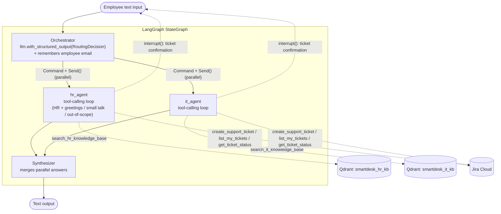
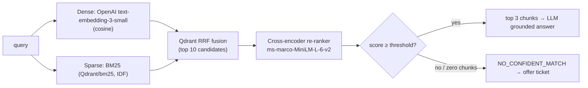

# SmartDeskAiAssistant — "Moxa"

Moxa is Synergy Inc's HR & IT help-desk chatbot. It is a multi-agent LangGraph application that:

1. **Answers questions** from the HR and IT knowledge bases using hybrid RAG (dense + BM25 + re-ranker), without hallucinating.
2. **Creates Jira tickets** when it can't answer. It collects the employee's email, drafts a summary and description, and asks the employee to confirm before submitting. After creation it returns the ticket ID and link.
3. **Checks ticket status**: it lists the employee's tickets, lets them pick one, and shows its status and the support team's comments.

---

## Architecture



### Retrieval pipeline (one per knowledge base)



### Graph flow

| Step | Node | What it does |
|---|---|---|
| 1 | `orchestrator` | Uses `llm.with_structured_output(RoutingDecision)`, a Pydantic model with `agents: list` and `reasoning`, to choose `hr_agent`, `it_agent`, or both. Pulls any email address out of the message and stores it in session state. Dispatches in parallel with `Command(goto=[Send(...)])`. Falls back to keyword routing if the LLM call fails. |
| 2 | `hr_agent` / `it_agent` | Each is a LangChain `create_agent` tool-calling loop with its KB search tool plus the Jira tools. `hr_agent` also handles greetings, small talk, and out-of-scope questions. Tickets get the label `HR` or `IT` automatically. |
| 3 | `synthesizer` | With a single answer it passes it through unchanged. With HR and IT answers it merges them into one reply using only the agents' content. |

### Confidence handling and escalation

Moxa combines four safeguards:

1. **Retrieval-score threshold.** A cross-encoder re-ranks the fused hybrid results. Chunks scoring below `RERANK_SCORE_THRESHOLD` (default `-4.0`) are dropped. Calibration on sample queries: direct hits scored ≥ 0.8, paraphrased hits as low as about −2.5, and unanswerable questions ≤ −5.5.
2. **No-retrieval fallback.** If nothing passes the threshold, the search tool returns `NO_CONFIDENT_MATCH`, which tells the agent to admit it doesn't know.
3. **LLM self-assessment.** The system prompts forbid outside knowledge. When the retrieved context doesn't answer the question, the agent must say *"I don't have enough information…"*.
4. **Human-in-the-loop.** The agent *offers* a ticket and only creates one once the employee agrees. The `create_support_ticket` tool then calls LangGraph `interrupt()` to show the full ticket. Nothing is submitted until the employee explicitly answers **yes**. Answering **no** cancels. Any other reply is appended to the description and the ticket is shown again.

### Session and error handling

- **Session memory.** An `InMemorySaver` checkpointer keeps one thread per CLI session. Conversation history and the employee's email persist across turns, so Moxa never asks for the email twice. A later address only replaces the stored one when it is clearly the employee's own (for example "my email is …"); a colleague's address mentioned in passing does not. `/new` starts a fresh session.
- **LLM failures.** OpenAI calls retry with exponential backoff (`LLM_MAX_RETRIES`). Every node also has a graceful fallback: keyword routing, an apology message, or concatenated answers.
- **Jira failures.** Jira calls use a short timeout. If Jira is unreachable or misconfigured, the agent apologises and suggests trying again later.
- **Secrets.** All secrets come from environment variables or `.env`. Nothing is hard-coded.

---

## Project layout

```
smartDeskAiAssistant/
├── smartDeskAi/
│   ├── main.py              # CLI entry point (chat loop, interrupt handling)
│   ├── config.py            # LLM, embeddings, Qdrant & Jira settings (from env)
│   ├── state.py             # SmartDeskState (TypedDict) + Send() payload
│   ├── graph.py             # StateGraph builder & compiler
│   ├── logger.py            # Centralized logging (console + log/app.log)
│   ├── agents/
│   │   ├── prompts.py       # System prompts: Orchestrator, HR, IT, Synthesizer
│   │   ├── orchestrator.py  # Structured-output router, Command + Send()
│   │   ├── specialist.py    # Shared tool-calling agent builder
│   │   ├── hr_agent.py
│   │   ├── it_agent.py
│   │   └── synthesizer.py
│   ├── tools/
│   │   ├── rag.py           # Qdrant hybrid search + re-ranker
│   │   ├── hr_tools.py      # search_hr_knowledge_base
│   │   ├── it_tools.py      # search_it_knowledge_base
│   │   ├── ticket_tools.py  # create (HITL) / list / status tools
│   │   └── jira_ticketing.py# Jira REST client helpers
│   └── data/
│       ├── hr_kb.json
│       └── it_kb.json
├── pyproject.toml
├── .env.example
└── README.md
```

Each KB entry is a short Q&A pair (≤ 465 characters), so each entry is indexed as one chunk, stored as `Question: … Answer: …`.

---

## Setup

Prerequisites: Python 3.12, [uv](https://docs.astral.sh/uv/), an OpenAI API key, and a Jira Cloud project.

```bash
uv sync                     # install dependencies into .venv
cp .env.example .env        # then fill in your keys
```

On the first run Moxa downloads the BM25 and re-ranker models (about 100 MB, via fastembed) and indexes both knowledge bases into `./.qdrant_data`. Later runs reuse the index.

### Environment variables

| Variable | Required | Default | Purpose |
|---|---|---|---|
| `OPENAI_API_KEY` | ✅ | — | LLM and embeddings |
| `JIRA_SERVER` | ✅ for tickets | — | e.g. `https://your-domain.atlassian.net` |
| `JIRA_EMAIL` | ✅ for tickets | — | Jira account used by the bot |
| `JIRA_API_TOKEN` | ✅ for tickets | — | Jira API token |
| `JIRA_PROJECT_KEY` | | `IKCS` | Project tickets are created in |
| `JIRA_TIMEOUT` | | `15` | Seconds before Jira is treated as unreachable |
| `LLM_MODEL` | | `gpt-4o` | Chat model |
| `EMBEDDING_MODEL` | | `text-embedding-3-small` | Dense embeddings |
| `LLM_MAX_RETRIES` / `LLM_TIMEOUT` | | `3` / `60` | OpenAI retry and timeout |
| `QDRANT_URL` / `QDRANT_API_KEY` | | — | Use a Qdrant server instead of embedded mode |
| `QDRANT_PATH` | | `./.qdrant_data` | Embedded Qdrant storage folder |
| `RERANK_SCORE_THRESHOLD` | | `-4.0` | Re-ranker confidence cut-off |
| `LANGSMITH_*` | | — | Optional LangSmith tracing |

> **Jira notes:** tickets are created as issue type `Bug`, with the employee set as **reporter**, so the employee's email must belong to a Jira user in your site. The email must match exactly; if it doesn't, Moxa asks the employee to check it. The bot's Jira account needs the *Modify Reporter* permission. Moxa's `Critical` priority maps to Jira's `Highest`. Status checks only return tickets reported by the employee's email.

---

## Run

```bash
uv run python -m smartDeskAi.main             # start chatting with Moxa
uv run python -m smartDeskAi.main --reindex   # rebuild the Qdrant collections from the JSON files
uv run python -m smartDeskAi.main --verbose   # show routing / retrieval logs and errors in the console
uv run python -m smartDeskAi.main --graph     # print the compiled LangGraph as Mermaid
```

Detailed logs are always written to `log/app.log`.

### Example session

```
You: What's the dress code, and how do I reset my password?
Moxa: **Dress Code:** Synergy Inc follows a business casual dress code ...
      **Password Reset:** Go to the self-service password reset portal ...

You: My laptop screen is cracked, what should I do?
Moxa: I don't have enough information on that in our IT knowledge base. Would you like me to raise a ticket?
You: yes please
Moxa: Could you please provide your email address?
You: jane.doe@synergy.com
Moxa: Here is the ticket I will create for you:
        Summary     : Cracked laptop screen
        Description : The employee reported that their laptop screen is cracked ...
        Priority    : Medium
        Label       : IT
      Shall I go ahead? (yes / no — or type extra details to add them to the description)
You: yes
Moxa: Your ticket has been created. Ticket ID: IKCS-42 — https://your-domain.atlassian.net/browse/IKCS-42

You: What is the status of my ticket?
Moxa: IKCS-42 "Cracked laptop screen" is In Progress. Latest comment from IT: ...
```
