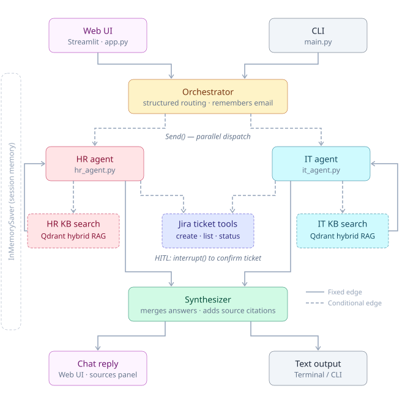
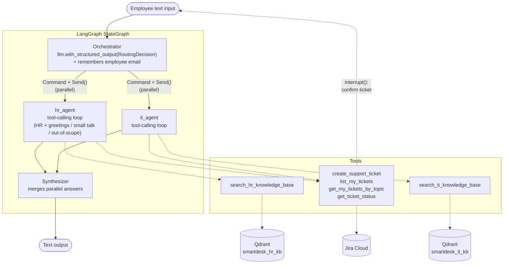
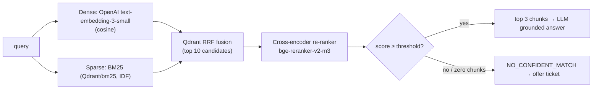
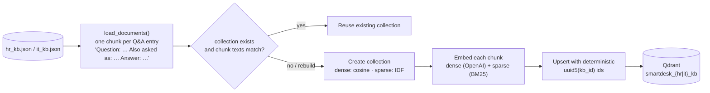
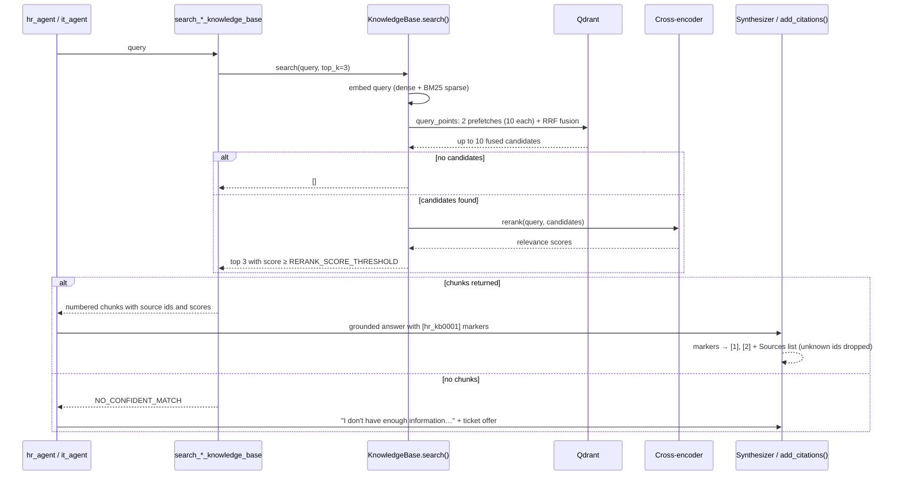

# SmartDeskAiAssistant — "Moxa"

## Key points before diving into details

1. I have given a fictitious name to the company **Synergy.Inc** and the SmartDeskAiAssistant as **Moxa**.
2. The HR and IT knowledge bases are combined from curated entries from these Hugging Face datasets: [EmbraceCoder/New_Hr_Policy](https://huggingface.co/datasets/EmbraceCoder/New_Hr_Policy), [w1z4rd3k/it-support-l1-ticket-classification](https://huggingface.co/datasets/w1z4rd3k/it-support-l1-ticket-classification) and LLM generated ones for sufficient depth and breadth
3. UI is implemented using Streamlit framework, there is a landing page with sign-in screen emulating VPN logging for Synergy.Inc. It takes work email and password that is automatically filled in by default (medha_j@yahoo.com/ikcapstone) and takes to the chatbot screen.
4. Ticketing system used is Jira. Project space name is IK_Capstone and space key is IKCS. As Jira needs preadded user, medha_j@yahoo.com is already added, full ticketing flow can be excercised successfully by setting environment variable JIRA_EMAIL=medha_j@yahoo.com
5. Known gaps for ticket creation workflow are following questions
   - How many days of paternity leave one can take?
   - My laptop screen is cracked
   - how many days of disability leave?
   - my vpn is not working
6. There are already some Jira tickets created by Reporter medha_j@yahoo.com for Jira ticket status flow
7. The application is ready with full production grade logging (log rotation and maximum 3 log files kept), Langsmith monitoring and extensive evaluations making sure that chatbot doesn't hallucinate. Ihe evals include routing, faithfulness, correctness, and retrieval (Hybrid RAG) evals. Experimenting and fine tuning RAG eval was very educating experience changing model to BAAI/BGE-reranker and mainly adding automatic paraphrasing
8. The code is written with the help Claude with very opinionated view and specific instructions given in statementsmartDeskAiAssitantSpec.txt which is prepared from the project problem statement
9. I became the first one in the class to have comprehensive menu and all operations integrated on UI, to experiment extensively with evals, to give a name to company and agent and demo it to the whole class. Please check with our cohort mentor Boyu Wang for more details.
11. On Github, this is the version (on main branch) without docker. There is a dockerized version on docker branch.
12. I will be traveling from Nov 20 to Dec 17 to India. Kindly contact on email (medha_j@yahoo.com) for any questions or if there are blockers (like Jira or Langsmith)

## Deployment
Deployed on AWS account and EC2 instance (http://ec2-18-191-7-37.us-east-2.compute.amazonaws.com:8501/). Deployment can be  made production grade in future with SSL, endpoint can be given proper FQDN, with scalability and high availability configurations using ECS or EKS.

## Overview

Moxa is Synergy Inc's HR & IT help-desk chatbot. It is a multi-agent LangGraph application that:

1. **Answers questions** from the HR and IT knowledge bases using hybrid RAG (dense + BM25 + re-ranker), without hallucinating.
2. **Creates Jira tickets** when it can't answer. It collects the employee's email, drafts a summary and description, and asks the employee to confirm before submitting. After creation it returns the ticket ID and link.
3. **Checks ticket status**: it lists the employee's tickets, lets them pick one, and shows its status and the support team's comments.

---

## Architecture

### High-level architecture



### Agent graph and tools



### Retrieval pipeline (one per knowledge base)



#### Indexing (on first start, or on rebuild)



#### Search request, end to end



### Graph flow

| Step | Node | What it does |
|---|---|---|
| 1 | `orchestrator` | Uses `llm.with_structured_output(RoutingDecision)`, a Pydantic model with `agents: list` and `reasoning`, to choose `hr_agent`, `it_agent`, or both. For a mixed HR + IT message it also splits the message into `hr_question` and `it_question`, and each agent sees only its own part as the employee's latest message, so neither tries to answer (or says it can't answer) the other's half. Pulls any email address out of the message and stores it in session state. Dispatches in parallel with `Command(goto=[Send(...)])`. Falls back to keyword routing if the LLM call fails. |
| 2 | `hr_agent` / `it_agent` | Each is a LangChain `create_agent` tool-calling loop with its KB search tool plus the Jira tools. `hr_agent` also handles greetings, small talk, and out-of-scope questions. Tickets get the label `HR` or `IT` automatically. |
| 3 | `synthesizer` | With a single answer it passes it through unchanged. With HR and IT answers it merges them into one reply using only the agents' content. |

### Confidence handling and escalation

Moxa combines five safeguards:

1. **Retrieval-score threshold.** A cross-encoder re-ranks the top `RERANK_CANDIDATES` (default 5) fused hybrid results. Chunks scoring below `RERANK_SCORE_THRESHOLD` (default `-5.0`, for `BAAI/bge-reranker-v2-m3-int8`) are dropped. The threshold favours answering: on the retrieval eval it answers 94% of answerable questions, but near-miss out-of-scope questions ("maternity leave" vs the leave allowance, "screen sharing" vs data handling) score up to about −4, so a quarter of the 40 out-of-scope questions pass. Those are left to safeguard 3, the agent's own relevance check, which declined all 10 such near-misses in the answer eval with gpt-4o. A stricter −3.0 would reject 95% of them at retrieval, at the cost of 2 of 67 answerable questions. Re-check this trade-off if you switch to a weaker `LLM_MODEL`. The eval's threshold sweep shows the tradeoff. Scores vary by about ±0.3 with the batch of candidates they're scored with, so don't read much into single cases near the threshold. The score scale depends on the model, so re-tune the threshold with `moxa-eval-retrieval` whenever `RERANK_MODEL` changes.
2. **No-retrieval fallback.** If nothing passes the threshold, the search tool returns `NO_CONFIDENT_MATCH`, which tells the agent to admit it doesn't know.
3. **LLM self-assessment.** The system prompts forbid outside knowledge. When the retrieved context doesn't answer the question, the agent must say *"I don't have enough information…"*.
4. **Source citations.** Agents cite the knowledge-base entry behind each fact (e.g. `[hr_kb0001]`). Before the reply is sent, these markers become numbered references `[1]` with a **Sources** list showing the knowledge base, category and original question. IDs that don't exist in either knowledge base are dropped, so a made-up citation is never shown.
5. **Human-in-the-loop.** The agent *offers* a ticket and only creates one once the employee agrees. The `create_support_ticket` tool then calls LangGraph `interrupt()` to show the full ticket. Nothing is submitted until the employee explicitly answers **yes**. Answering **no** cancels. Any other reply is appended to the description and the ticket is shown again.

### Session and error handling

- **Session memory.** An `InMemorySaver` checkpointer keeps one thread per CLI session. Conversation history and the employee's email persist across turns, so Moxa never asks for the email twice. A later address only replaces the stored one when it is clearly the employee's own (for example "my email is …"); a colleague's address mentioned in passing does not. `/new` starts a fresh session.
- **LLM failures.** OpenAI calls retry with exponential backoff (`LLM_MAX_RETRIES`). Every node also has a graceful fallback: keyword routing, an apology message, or concatenated answers.
- **Jira failures.** Jira calls use a short timeout. If Jira is unreachable or misconfigured, the agent apologises and suggests trying again later.
- **Secrets.** All secrets come from environment variables or `.env`. Nothing is hard-coded.

---

## Project layout

```
smartDeskAiAssistant/
├── smartDeskAi/
│   ├── main.py              # CLI entry point (chat loop, interrupt handling)
│   ├── app.py               # Streamlit web UI
│   ├── launch_ui.py         # `uv run moxa-ui` launcher for app.py
│   ├── auth.py              # Email + password sign-in (uv run moxa-hash-password)
│   ├── config.py            # LLM, embeddings, Qdrant & Jira settings (from env)
│   ├── state.py             # SmartDeskState (TypedDict) + Send() payload
│   ├── graph.py             # StateGraph builder & compiler
│   ├── logger.py            # Centralized logging (console + log/app.log)
│   ├── agents/
│   │   ├── prompts.py       # System prompts: Orchestrator, HR, IT, Synthesizer
│   │   ├── orchestrator.py  # Structured-output router, Command + Send()
│   │   ├── specialist.py    # Shared tool-calling agent builder
│   │   ├── hr_agent.py
│   │   ├── it_agent.py
│   │   └── synthesizer.py
│   ├── tools/
│   │   ├── rag.py           # Qdrant hybrid search + re-ranker
│   │   ├── kb_phrasings.py  # LLM-generated alternate phrasings per KB entry (uv run moxa-kb-phrasings)
│   │   ├── hr_tools.py      # search_hr_knowledge_base
│   │   ├── it_tools.py      # search_it_knowledge_base
│   │   ├── ticket_tools.py  # create (HITL) / list / status tools
│   │   └── jira_ticketing.py# Jira REST client helpers
│   ├── evaluation/
│   │   ├── routing_eval.py      # Routing evaluation (uv run moxa-eval-routing)
│   │   ├── routing_langsmith.py # --langsmith: dataset sync + LangSmith experiment
│   │   ├── routing_dataset.json # Labeled conversations -> expected agents
│   │   ├── retrieval_eval.py      # Retrieval evaluation (uv run moxa-eval-retrieval)
│   │   ├── retrieval_langsmith.py # --langsmith: dataset sync + LangSmith experiment
│   │   ├── retrieval_dataset.json # Labeled questions -> KB entries that answer them
│   │   ├── answer_eval.py         # Faithfulness & correctness evaluation (uv run moxa-eval-answers)
│   │   ├── answer_judges.py       # LLM-as-judge graders (JUDGE_MODEL)
│   │   ├── answer_langsmith.py    # --langsmith: dataset sync + LangSmith experiment
│   │   └── answer_dataset.json    # Questions -> reference answers + expected KB sources
│   └── data/
│       ├── hr_kb.json
│       └── it_kb.json
├── docs/
│   └── high_level_architecture.svg
├── pyproject.toml
├── .env.example
├── .streamlit/secrets.toml.example   # Registered employees for sign-in (template)
└── README.md
```

Each KB entry is a short Q&A pair (≤ 465 characters), so each entry is indexed as one chunk, stored as `Question: … Answer: …`.

---

## Setup

Prerequisites: Python 3.12, [uv](https://docs.astral.sh/uv/), an OpenAI API key, and a Jira Cloud project.

```bash
uv sync                     # install dependencies + the smartDeskAi package (editable) into .venv
cp .env.example .env        # then fill in your keys
```

On the first run Moxa downloads the BM25 and re-ranker models (about 100 MB, via fastembed) and indexes both knowledge bases into `./.qdrant_data`. Later runs reuse the index.

### Environment variables

| Variable | Required | Default | Purpose |
|---|---|---|---|
| `OPENAI_API_KEY` | ✅ | — | LLM and embeddings |
| `JIRA_SERVER` | ✅ for tickets | — | e.g. `https://your-domain.atlassian.net` |
| `JIRA_EMAIL` | ✅ for tickets | — | Jira account used by the bot |
| `JIRA_API_TOKEN` | ✅ for tickets | — | Jira API token |
| `JIRA_PROJECT_KEY` | | `IKCS` | Project tickets are created in |
| `JIRA_TIMEOUT` | | `15` | Seconds before Jira is treated as unreachable |
| `LLM_MODEL` | | `gpt-4o` | Chat model |
| `EMBEDDING_MODEL` | | `text-embedding-3-small` | Dense embeddings |
| `LLM_MAX_RETRIES` / `LLM_TIMEOUT` | | `3` / `60` | OpenAI retry and timeout |
| `QDRANT_URL` / `QDRANT_API_KEY` | | — | Use a Qdrant server instead of embedded mode |
| `QDRANT_PATH` | | `./.qdrant_data` | Embedded Qdrant storage folder |
| `RERANK_MODEL` | | `BAAI/bge-reranker-v2-m3-int8` | FastEmbed cross-encoder used for re-ranking |
| `RERANK_SCORE_THRESHOLD` | | `-5.0` | Re-ranker confidence cut-off (model-specific) |
| `RERANK_CANDIDATES` | | `5` | How many of the fused hybrid results the cross-encoder re-ranks (fewer = faster) |
| `LANGSMITH_*` | | — | Optional LangSmith tracing |

> **Jira notes:** tickets are created as issue type `Bug`, with the employee set as **reporter**, so the employee's email must belong to a Jira user in your site. The email must match exactly; if it doesn't, Moxa asks the employee to check it. The bot's Jira account needs the *Modify Reporter* permission. Moxa's `Critical` priority maps to Jira's `Highest`. Status checks only return tickets reported by the employee's email.

---

## Run

```bash
uv run moxa                                   # start chatting with Moxa
uv run python -m smartDeskAi.main             # same thing, as a module
uv run python -m smartDeskAi.main --reindex   # rebuild the Qdrant collections from the JSON files
uv run moxa-kb-phrasings                      # add alternate phrasings to KB entries that lack them (review before committing)
uv run python -m smartDeskAi.main --verbose   # show routing / retrieval logs and errors in the console
uv run python -m smartDeskAi.main --graph     # print the compiled LangGraph as Mermaid
```

Detailed logs are always written to `log/app.log`.

### Web UI (Streamlit)

```bash
uv run moxa-ui                                # open the chat UI at http://localhost:8501
uv run streamlit run smartDeskAi/app.py       # same thing, via Streamlit directly
uv run moxa-ui -- --reindex                   # rebuild the Qdrant collections, then open the UI
```

The web UI uses the same graph as the CLI. Each browser tab is its own session, and **➕ New session** in the sidebar starts a fresh one. Ticket confirmations appear as a card with **Create ticket** / **Cancel** buttons and a form for changing the priority or adding details. You can also type the reply in the chat box. The sidebar shows the email Moxa has stored for the session.

**About Moxa → Hybrid RAG → Rebuild RAG** does the same from the UI, after a confirmation: it restarts the server in place with `-- --reindex` (same port), and the open page reconnects by itself. The restart affects everyone using Moxa: all open chats and sign-ins are lost, and Moxa is unavailable while the knowledge bases re-index on the first sign-in afterwards.

#### Sign-in (required)

The web UI opens on the **HR and IT Portal** landing page, and employees must sign in there before Moxa loads. Employees are pre-registered and sign in with their work email and a predefined password. The signed-in email is used for their tickets, so Moxa never asks for it, and it can't be changed from the chat. To register employees:

1. `cp .streamlit/secrets.toml.example .streamlit/secrets.toml`. This file is git-ignored.
2. For each employee, run `uv run moxa-hash-password`, type their password, and paste the printed hash into their `[users."email"]` entry along with their `name`. Only the hash is stored, never the password.
3. Restart the UI. Until at least one employee is registered, the landing page shows a setup message instead of the sign-in form.

Sign-in lasts for the browser session: refreshing the page or choosing **Sign out** (under the employee's name, top right) returns to the landing page and starts a new conversation. The CLI (`uv run moxa`) has no sign-in.

### Example session

```
You: What's the dress code, and how do I reset my password?
Moxa: **Dress Code:** Synergy Inc follows a business casual dress code ...
      **Password Reset:** Go to the self-service password reset portal ...

You: My laptop screen is cracked, what should I do?
Moxa: I don't have enough information on that in our IT knowledge base. Would you like me to raise a ticket?
You: yes please
Moxa: Could you please provide your email address?
You: jane.doe@synergy.com
Moxa: Here is the ticket I will create for you:
        Summary     : Cracked laptop screen
        Description : The employee reported that their laptop screen is cracked ...
        Priority    : Medium
        Label       : IT
      Shall I go ahead? (yes / no — or type extra details to add them to the description)
You: yes
Moxa: Your ticket has been created. Ticket ID: IKCS-42 — https://your-domain.atlassian.net/browse/IKCS-42

You: What is the status of my ticket?
Moxa: IKCS-42 "Cracked laptop screen" is In Progress. Latest comment from IT: ...
```

---

## Tests

```bash
uv run pytest                      # everything (~1s)
uv run pytest tests/unit           # unit tests only
uv run pytest -m integration       # end-to-end graph tests only
```

The tests need no API keys or network: `tests/conftest.py` overrides `.env` with dummy values and turns
LangSmith tracing off, so they never call OpenAI, Jira, LangSmith or the on-disk Qdrant data.

- **Unit tests** (`tests/unit/`) cover sign-in and password hashing, routing helpers (email resolution,
  keyword fallback, message splitting), ticket-confirmation parsing, the ticket tools and Jira wrapper
  (against a fake Jira), citations and search-result formatting, the synthesizer, and CLI helpers.
- **Integration tests** (`tests/integration/`) run the real compiled LangGraph graph with a scripted chat
  model, in-memory knowledge bases and stubbed Jira calls: KB answers with sources, mixed HR + IT messages
  answered in parallel and merged, router and agent failures, ticket creation through `interrupt()`/resume
  (edit, confirm, decline, web-UI edits, unknown email), and per-thread memory of the employee's email.

The live quality checks against the real models and knowledge bases are the evaluations below.

---

## Evaluation

### Routing decisions

```bash
uv run moxa-eval-routing                      # score the orchestrator on the labeled dataset
uv run moxa-eval-routing --repeats 3          # run each case 3 times to measure consistency
uv run moxa-eval-routing --min-accuracy 0.95  # exit with status 1 below 95% (for CI)
uv run moxa-eval-routing --dataset my_cases.json --output results.json
uv run moxa-eval-routing --langsmith          # also run it as a scored LangSmith experiment
```

This calls the orchestrator's LLM router with the same prompt and history window it uses in the graph, so no sub-agents, RAG or Jira calls run. Each case in [`routing_dataset.json`](smartDeskAi/evaluation/routing_dataset.json) is a conversation that ends with the employee's latest message, plus the agents that should handle it:

```json
{"id": "followup-01", "category": "follow_up",
 "messages": [{"role": "user", "content": "My laptop won't turn on."},
              {"role": "assistant", "content": "... would you like me to raise an IT ticket?"},
              {"role": "user", "content": "yes please"}],
 "expected": ["it_agent"]}
```

The dataset covers HR, IT and mixed questions, small talk, out-of-scope requests, ticket status, follow-ups and topic switches. The report shows exact-match accuracy, per-agent precision/recall/F1, accuracy per category, a table of expected vs predicted agents, latency, every misrouted case with the router's reasoning and, with `--repeats`, how consistent the router is. The keyword fallback is scored too, as a baseline. Full results are written to `log/routing_eval_<timestamp>.json`.

#### Viewing the evaluation in LangSmith

Run with `--langsmith` (needs `LANGSMITH_API_KEY`). This:

1. Syncs the cases to the LangSmith dataset **Moxa routing decisions** (use `--langsmith-dataset NAME` for a different one). Examples are matched by case id, so editing `routing_dataset.json` and re-running adds, updates or removes examples instead of duplicating them.
2. Runs the router over the dataset as an experiment named `routing-<model>-<id>`, and prints a link to it.
3. Scores every run with `exact_match`, `hr_agent_correct` and `it_agent_correct`, and the whole experiment with `accuracy` plus precision, recall and F1 for each agent.

In LangSmith, open **Datasets & Experiments → Moxa routing decisions**. The **Experiments** tab lists every run with its scores. Select two or more and click **Compare** to see, case by case, where routing changed after a prompt or model change. Each experiment records `model` and `prompt_sha` (a hash of `ORCHESTRATOR_PROMPT`) as metadata, so you can tell versions apart. Click a row to see the conversation, the router's choice and reasoning, and the full trace. `--repeats N` runs each case N times within one experiment.

Without `--langsmith`, router calls are still traced (when `LANGSMITH_TRACING` is on) in your `LANGSMITH_PROJECT` with the `routing-eval` tag, but they aren't scored.

### Retrieval

```bash
uv run moxa-eval-retrieval                       # score the hybrid retriever on the labeled questions
uv run moxa-eval-retrieval --min-hit-rate 0.9    # exit with status 1 below 90% pipeline accuracy (for CI)
uv run moxa-eval-retrieval --dataset my_queries.json --output results.json
uv run moxa-eval-retrieval --langsmith           # also run it as a scored LangSmith experiment
```

This runs only the retriever, against the real Qdrant collections, so no LLM answers are generated. Each case in [`retrieval_dataset.json`](smartDeskAi/evaluation/retrieval_dataset.json) is a question, the knowledge base it is searched in, and the entries that answer it (any one counts as a hit). Out-of-scope questions expect no entries, because the confidence threshold should reject them:

```json
{"id": "it-r09", "kb": "it", "category": "paraphrase", "query": "I left my work phone in a taxi", "expected": ["it_kb0010"]}
{"id": "hr-o01", "kb": "hr", "category": "out_of_scope", "query": "Does the company offer free gym memberships?", "expected": []}
```

The dataset covers paraphrased questions, short keyword queries, typos and out-of-scope questions. The report has two parts:

- **Per stage** (answerable questions): Hit@1, Hit@3, Recall@3 and MRR for dense search, BM25, RRF fusion and the re-ranked list, so you can see what each stage adds.
- **End to end** (re-ranked top 3, then `RERANK_SCORE_THRESHOLD`, which is what an agent actually sees): pipeline accuracy, answerable questions answered correctly, false rejections (nothing passed the threshold), correct rejections of out-of-scope questions, and a threshold sweep for tuning `RERANK_SCORE_THRESHOLD`.

Failed questions are listed with their top 3 entries and re-rank scores. Full results are written to `log/retrieval_eval_<timestamp>.json`. With `--langsmith` the questions are synced to the dataset **Moxa retrieval**. Each run is scored with `correct`, `hit_at_1`, `hit_at_3` and `reciprocal_rank`, and each experiment with the end-to-end rates plus Hit@3 and MRR per stage. Experiments record the models, top k and threshold as metadata.

### Answer faithfulness & correctness

```bash
uv run moxa-eval-answers                          # run Moxa end to end and grade every answer
uv run moxa-eval-answers --min-faithfulness 0.95 --min-correctness 0.85   # exit with status 1 below either (for CI)
uv run moxa-eval-answers --dataset my_questions.json --output results.json
uv run moxa-eval-answers --langsmith              # also run it as a scored LangSmith experiment
```

Each question runs through the whole graph, as it would in a chat: orchestrator, HR/IT agents with hybrid RAG, then the synthesizer. No employee email is set, so no Jira calls are made. A callback records every knowledge-base search result the agents saw. An LLM judge (`JUDGE_MODEL`, default `LLM_MODEL`, temperature 0) then grades the final answer. Each case in [`answer_dataset.json`](smartDeskAi/evaluation/answer_dataset.json) has a question, a reference answer written from the knowledge base, and the entries it comes from:

```json
{"id": "hr-a02", "category": "hr", "question": "How many sick days do I get, and do I need a doctor's note?",
 "reference": "7 days of paid sick leave per year. ... A medical certificate may be required for absences longer than 3 consecutive days.",
 "expected_sources": ["hr_kb0036"]}
```

- **Faithfulness**: the judge splits the answer into factual claims and checks each one against the retrieved context only, never general knowledge. The score is supported claims ÷ claims. An answer below 1.0 contains a hallucination. Answers with no factual claims (greetings, "I don't have enough information") score 1.0.
- **Correctness**: the judge compares the answer with the reference: *correct* (1.0), *partially correct* (0.5, key facts missing) or *incorrect* (0.0, contradicts the reference, invents details for an unanswerable question, or refuses one the KB answers). It lists missing and wrong facts.
- **Citation checks** (deterministic, from the agents' `[hr_kb0001]` markers): *citation validity* (cited entries were in the search results), *source hit* (an expected entry was cited, one per knowledge base for mixed questions), and *false/correct abstentions* (answerable questions with no citation, and out-of-scope questions with none).

The report breaks the scores down by category (HR, IT, mixed, out of scope). It lists each flagged answer with its unsupported claims and its wrong and missing facts. Full results, including each answer and its retrieved context, are written to `log/answer_eval_<timestamp>.json`. With `--langsmith` the questions are synced to the dataset **Moxa answers**. Each run is scored with `faithfulness`, `correctness` (the judge's reasoning is the comment), `citation_validity`, `source_hit` and `abstained_correctly`. Each experiment gets the mean scores, and records the answering and judge models plus a hash of the agent prompts as metadata. Judge verdicts are cached, so the local report doesn't grade the answers a second time.

All three evaluations can also be run from the web UI: **About Moxa → Evaluate**, with one tab each for **Routing**, **Faithfulness & Correctness** and **Retrieval**.
